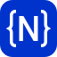
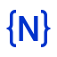
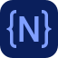
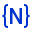
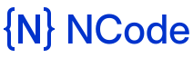
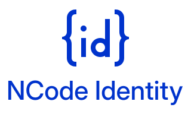

# 1. Marks

The NCode mark is `{N}`: N for NCode, inside the curly braces of code. [logo/ncode/](../logo/ncode/) holds it as vector
masters and as the PNG and ICO files each place it appears in asks for. build.mjs draws every one of them from
[src/logo/ncode.json](../src/logo/ncode.json), in the colors of the blue ramp.

| Tile, blue | Tile, white | Tile, dark | Mark | Lockup |
|---|---|---|---|---|
|  |  |  |  |  |

Each product has a mark of the same construction, its own letters between the same braces: `{id}` for NCode Identity.
[logo/identity/](../logo/identity/) holds its kit, drawn by the same code from
[src/logo/identity.json](../src/logo/identity.json): [The `{id}` Kit](#the-id-kit) says where it differs.

## The Names

Write **NCode**, **NCode Group**, **NCode Identity** and **NCode Buffers**: a capital N and C, and a space before a
product's name.
`NCode.Identity` and `NCode.Buffers` are package and namespace names; use them only where code or a package is meant.

## Which File for What

Every path is under `logo/ncode/`. The `{id}` kit's are under `logo/identity/`. Where a row names a folder's blue
tile, the folder also holds the other [variants](#variants).

| Use | File | What it is |
|---|---|---|
| NuGet package icon | `nuget/ncode-nuget-tile-blue.png` | 128 by 128, the size NuGet recommends. Clients scale it down, to as little as 32 pixels, on a white page and in a dark IDE alike, which is why it is a tile |
| Website favicon | Every file in `favicon/`, with the tags under [Favicon](#favicon) | An ICO with its own drawing for each of 16, 20, 24, 32, 40, 48 and 64 pixels, an SVG, the 180-pixel icon iOS takes, and the 192- and 512-pixel icons a web manifest names, one of them maskable |
| GitHub organization or user picture | `github/ncode-github-avatar-tile-blue.png` | 500 by 500, the size GitHub recommends, with no transparency. For a picture GitHub cuts to a circle, take `profile/` |
| GitHub repository social preview | `github/ncode-github-social-light.png`, `-dark.png` or `-blue.png` | 1280 by 640, the size GitHub recommends |
| GitLab group or project avatar | `gitlab/ncode-gitlab-avatar-tile-blue.png` | 192 by 192, GitLab's ideal size, far below its 200 KiB limit |
| GitLab project avatar, from the repository | `gitlab/logo.png`, copied to the repository's root | GitLab shows a `logo.png` at the root as the project's avatar until one is uploaded |
| My Apps and the Microsoft 365 app launcher | `myapps/ncode-myapps-tile-blue.png` | Exactly 215 by 215, PNG, with a solid background, as Microsoft Entra asks. No transparent variant, for that reason |
| Profile picture cut to a circle | `profile/ncode-profile-tile-blue.png` | 1024 by 1024, with the mark inside the circle: GitHub and GitLab users, Gravatar, X, LinkedIn |
| Badge logo | `badge/shields-logo-white.txt`, as under [Badges](#badges) | The mark cropped to its edges, as the value of Shields.io's `logo` parameter |
| Link preview | `social/ncode-og-light.png`, `-dark.png` or `-blue.png` | 1200 by 630, the Open Graph size |
| Profile banner | `social/ncode-banner-light.png`, `-dark.png` or `-blue.png` | 1500 by 500 |
| Windows application icon | `windows/ncode.ico` | 16 to 64 pixels as 32-bit bitmaps and 256 as PNG, the layout a Windows application icon has, for `<ApplicationIcon>` in a project file |
| README, documentation, slides, print | The SVG files in `lockup/`, `mark/` and `tile/` | Vector, at any size. Each also comes as PNG |
| A page or a component that draws the mark inline | `outlines.json` | The mark, the lockup, the brace and each small size's own drawing, as SVG path data |

## Variants

| Name | Background | Mark | Use it on |
|---|---|---|---|
| `tile-blue` | NCode Blue | White | Anything: the default wherever the background isn't yours to choose |
| `tile-white` | White | NCode Blue | Anything, where a blue tile is too loud |
| `tile-dark` | NCode Navy | NCode Blue Light | Anything; made for dark pages |
| `mark-blue` | Transparent | NCode Blue | Light backgrounds only: on a dark page its contrast is 2 to 1 |
| `mark-light` | Transparent | NCode Blue Light | Dark backgrounds only |
| `mark-white`, `mark-black` | Transparent | White, black | One color: over a photograph or a color, in print, as a mask |
| `mark-auto`, `lockup-auto` (SVG only) | Transparent | NCode Blue, or NCode Blue Light in a dark color scheme | A page that follows the reader's system setting |

A tile's file has rounded corners with transparent pixels outside them where the picture is shown as it is (NuGet,
favicons, `tile/`), and fills the whole square where the platform cuts its own shape (`github/`, `gitlab/`, `myapps/`,
`profile/`, `apple-touch-icon.png`, the maskable icon, and the `-square` files in `tile/`).

The mark sits at one of three sizes in its square: across seven eighths of it where the picture is shown small (NuGet,
favicons, badges), a little smaller on tiles and avatars, and inside the center circle of 80% of the width where a
circle is cut from it (`profile/`, the maskable icon).

## Colors

The three colors are the anchors of the blue ramp, `blue.600`, `blue.300` and `blue.900` in
[src/tokens.source.json](../src/tokens.source.json), so the marks and the tokens cannot disagree.

| Name | Hex | Use |
|---|---|---|
| NCode Blue | `#0033CC` | The mark on light backgrounds; the tile. The blue the mark has always had |
| NCode Blue Light | `#809FFF` | The mark on dark backgrounds |
| NCode Navy | `#0A1F5C` | The dark tile and the dark cards |
| White | `#FFFFFF` | The mark on NCode Blue |

Contrast, as WCAG measures it: NCode Blue on white, and white on NCode Blue, 9.0 to 1; NCode Blue Light on GitHub's
dark page (`#0D1117`) 7.5 to 1, on Visual Studio's dark theme (`#1E1E1E`) 6.6 to 1 and on NCode Navy 6.1 to 1. NCode
Blue on a dark page is 2.1 to 1, too low to read: use the light mark or a tile there. Under a tenant's colors NCode's
marks go one color, the text color, and never take the tenant's hue
([Products and tenants](11-products-and-tenants.md)).

## The Drawing

- The master is drawn on a grid of 64 units from straight lines and circular arcs. The braces are a stroke of 4 units,
  48 high; the N is 24 wide and 32 high, with stems of 5. Every stem lies on a whole unit, so the mark is sharp at 64
  pixels and at its multiples.
- At 16, 20, 24, 32, 40 and 48 pixels the mark has a drawing of its own, with each stem on whole pixels. A scaled-down
  master puts them between pixels, which is what makes a small icon look soft. The ICO files and `favicon.svg` use
  these drawings.
- The wordmark is "NCode" in Inter Display Medium, version 4.000, converted to outlines, with capitals as tall and
  stems about as heavy as the mark's N. [src/logo/ncode.json](../src/logo/ncode.json) names the exact font file.
- Leave clear space around the mark of at least the width of one brace, 12 of its 64 units. The files in `mark/`
  already hold 4 units of it at the sides and 8 above and below.
- The smallest drawing is 16 pixels, 14 across its ink, which is also the size a badge shows the cropped mark at.
  Below that the braces do not read. Keep the lockup at least 24 pixels high.
- Don't stretch the mark, recolor it outside the palette, outline it, or set the braces in a font: a font's braces and
  the mark's differ.

## Favicon

Copy `favicon/` to the site's root, change `name` and `short_name` in `site.webmanifest`, and add:

```html
<link rel="icon" href="/favicon.ico" sizes="32x32">
<link rel="icon" href="/favicon.svg" type="image/svg+xml">
<link rel="apple-touch-icon" href="/apple-touch-icon.png">
<link rel="manifest" href="/site.webmanifest">
```

`favicon/transparent/` is the mark without a tile: blue in `favicon.ico`, light blue in `favicon-dark.ico`, and either
in `favicon.svg`, by the reader's color scheme.

```html
<link rel="icon" href="/favicon.ico" sizes="32x32" media="(prefers-color-scheme: light)">
<link rel="icon" href="/favicon-dark.ico" sizes="32x32" media="(prefers-color-scheme: dark)">
<link rel="icon" href="/favicon.svg" type="image/svg+xml">
```

## Badges

Shields.io takes a logo of its own as a data URI in the `logo` parameter and can't recolor it, so the mark comes in
three colors: white for a badge's default gray label, blue and light blue for a label color of your own. Each
`badge/shields-logo-<color>.txt` holds one line, ready to follow `logo=`:

```markdown

```

## In a README

Name a file by its address at a release's tag, so a README keeps the logo it was written with. GitHub shows the image
that matches the reader's theme when a `<picture>` names both:

```html
<picture>
  <source media="(prefers-color-scheme: dark)" srcset="https://raw.githubusercontent.com/NCodeGroup/brand/v0.1.0/logo/ncode/lockup/ncode-lockup-light.svg">
  
</picture>
```

nuget.org renders CommonMark only, so a package's README takes one image in Markdown: the blue lockup at the same
address.

## The `{id}` Kit

`logo/identity/` holds every file of the `{N}` kit, in the same folders, named `ncode-identity-` where the `{N}` kit
has `ncode-`, such as `nuget/ncode-identity-nuget-tile-blue.png` and `windows/ncode-identity.ico`; its
`site.webmanifest` names it "NCode Identity", "Identity" for short.

| Tile, blue | Tile, white | Tile, dark | Mark | Lockup | Lockup, stacked |
|---|---|---|---|---|---|
|  |  |  |  |  |  |

- *A stacked lockup*: `lockup/ncode-identity-lockup-stacked-<color>.svg`, and as PNG 384 and 1536 high. It sets the
  mark at twice its size above the wordmark, for a space nearer a square. Keep it at least 72 pixels high.
- *The descriptor*: the link previews, `social/ncode-identity-og-*.png`, and
  `github/ncode-identity-github-social-*.png` carry "OpenID Connect and OAuth 2.x for .NET" under the lockup, in
  Inter Display Regular. The banners carry the lockup alone.
- *The drawing*: the braces are point for point the `{N}` mark's. The letters have a stroke of 4: the d is 16 wide and
  32 high, with a ring 16 across as its bowl, and the i is as high as the bowl, under a dot 5 across. Up to 24 pixels
  the bowl is three bars around a hole, and up to 32 the dot is a square. Below 16 pixels the letters can't be told
  apart.
- *The wordmark*: "NCode Identity", two words, in Inter Display Medium from Inter 4.1, with capitals as tall as the
  d. [src/logo/identity.json](../src/logo/identity.json) names the font files.

Name its files by their address at a release's tag, as [In a README](#in-a-readme) says, with `logo/identity/` for
`logo/ncode/`.

## License

The marks are not under this repository's Apache License 2.0: they are trademarks of NCode Group, and their files are
copyright NCode Group, all rights reserved. [TRADEMARKS.md](../TRADEMARKS.md) says how you may use them.
